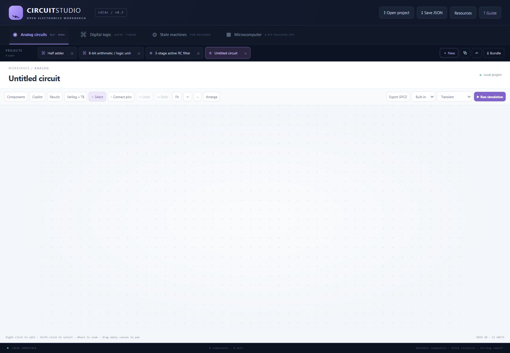
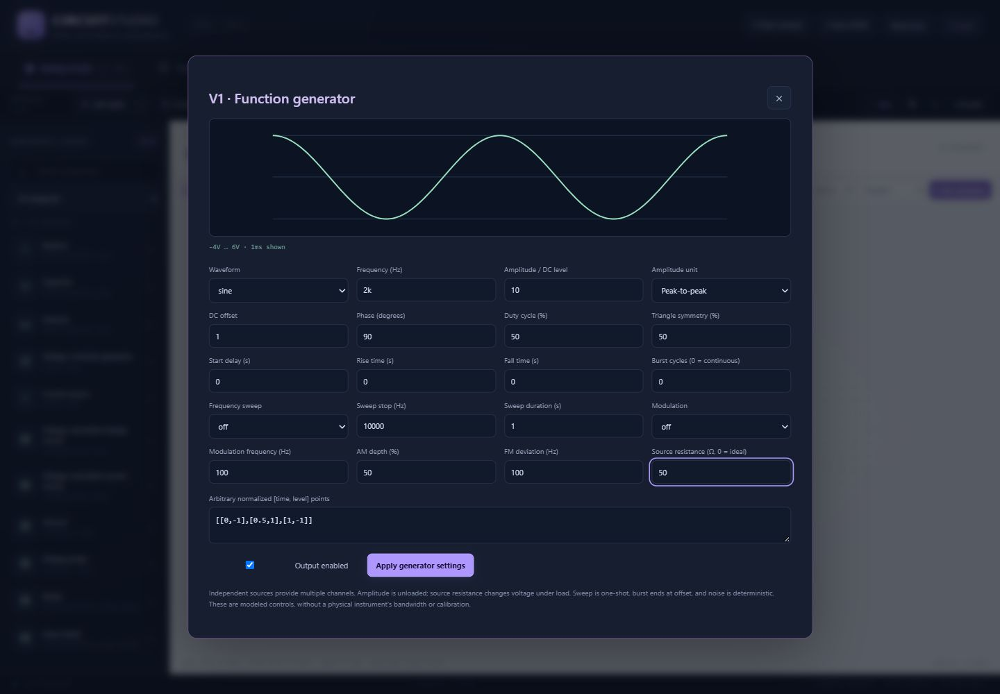

# Circuit Studio · v0.3.1

A local electronics workbench with editable SPICE component families, a lab-style function generator, external model resources, digital logic simulation, live Verilog/testbench generation, FSM and CPU labs, and multiple project tabs.



## Run

Install Node.js 22 or newer, then run from this folder:

```sh
node server.mjs
```

Open **http://127.0.0.1:3000**. Stop with Ctrl+C. There are no npm dependencies. Optional npm shortcuts remain available.

```sh
node --test
node scripts/check.mjs
```

For optional engine and AI settings, copy `.env.example` to `.env`, edit it, then use:

```sh
node --env-file=.env server.mjs
```

## Plain canvas and editable components

New installations start with an empty circuit and closed tool panels. There are no example cards, copilot greetings, or startup suggestions. **Components**, **Copilot**, **Results**, and **Verilog + TB** open tools when requested. Existing saved documents are preserved; the first v0.3 launch adds a blank tab, and subsequent launches restore the saved active document.

There is **one resistor, capacitor and inductor family each**, with editable values. Old valued presets remain readable in older projects but do not appear in the library. See [docs/CATALOG.md](docs/CATALOG.md) for the actual component families and engine requirements.

- **Right-click** a component for values/connections, rotate 90°, horizontal/vertical mirroring, multiple-copy duplication, and deletion. Double-click opens properties.
- **Shift-click** to select several components; drag to move the selection. Ctrl+A selects the circuit, R rotates, Ctrl+D duplicates, Delete removes. Undo/redo restores circuit edits.
- Duplication keeps connections inside the copied selection, assigns new external net names, and keeps ground shared. Choose 1–32 copies, subject to the 256-component document limit.
- Wheel zoom follows the cursor. **＋ / −**, **Fit**, and **Arrange** remain available. Drag empty canvas to pan. The camera can zoom out to a much larger area; component centers can be placed within a 20,000-unit canvas.
- Matching node names connect electrically; ground is `0`. Click a port and move the pointer to see a live wire preview. Nearby destination ports snap and turn green. Click the destination, or drag from the first port and release over the destination, to connect. Escape or clicking the starting port again cancels. Ground remains ground regardless of click order. To disconnect a pin, give it a new net name in properties.
- Values accept `4.7k`, `100n`, `1u` and `1meg`. `m`/`M` means milli; use `meg` for mega.

Each document supports up to 256 placed components. Up to 24 workspaces can be open. New, duplicate, close/reopen and bundle import/export remain available. Definitions autosave in this browser; circuit histories, runtime state, results and chat stay separate during tab switching and reset on reload. Download files/bundles for durable backups. Nothing commits, pushes or publishes automatically.

## SPICE component families

The library includes passives, independent sources, controlled sources, diode/zener/LED, NPN/PNP, NMOS/PMOS, N/P JFET, switches, generic op-amp/comparator, coupled-winding transformer, mutual inductance, behavioral sources, transmission line, ground and voltage probe.

These are **independent standard SPICE families and generic educational models**, not a copy of LTspice's complete manufacturer library or schematic assets. The application does not import `.asc` schematics or encrypted/proprietary models. Manufacturer-specific components can be added through compatible model resources. This follows the `.model` / `.subckt` approach documented in [Analog Devices' LTspice model import guide](https://www.analog.com/en/resources/technical-articles/ltspice-how-to-import-third-party-models.html).

### Built-in engine

R/C/L, independent V/I, E/G controlled sources, original linear blocks and simple imported linear subcircuits run without external software. DC operating point, backward-Euler transient and AC magnitude/phase are supported. Ground and probes are annotations. Analog blocks expand before analysis.

The built-in solver is linear and limited to 256 expanded MNA unknowns. It cannot simulate semiconductor physics, nonlinear behavioral expressions, mutual inductance or transmission lines. Those parts fail clearly instead of being silently ignored.

### Optional ngspice engine

Install ngspice separately and put it on PATH, or set an executable path in `.env`:

```text
NGSPICE_BIN=C:\Spice64\bin\ngspice_con.exe
```

Restart and select **ngspice** in the engine menu. The server exports a self-contained netlist, runs ngspice batch mode in a temporary directory, and reads ASCII raw results back into the same plot/table UI. A run is limited to 30 seconds; results are limited to 30 MB. The adapter uses the [official batch/raw-file interface](https://ngspice.sourceforge.io/docs/ngspice-manual.pdf).

**ngspice is not bundled or installed on the development machine.** Its netlist generation, result parser and HTTP integration were checked; real nonlinear engine execution remains unverified here. Generic models are approximate. Compatibility depends on the imported SPICE dialect and model syntax; arbitrary LTspice models are not guaranteed to work in ngspice.

## Function generator

Place a Voltage / function generator (or current source), right-click it, and choose **Function generator**.



Controls include:

- DC, sine, square, triangle, sawtooth, pulse, deterministic noise, and arbitrary normalized time/level waveforms.
- Frequency, peak or peak-to-peak amplitude, DC offset, phase, duty cycle and triangle symmetry.
- Start delay, rise/fall times, finite burst cycles, linear/log frequency sweep, AM depth, FM deviation and modulation frequency.
- Output enable and source resistance. Use 50 Ω for a typical generator output or 0 for an ideal source; actual load voltage depends on the circuit. Current-source resistance is modeled as a parallel output resistance.
- Live waveform preview. Place multiple independent sources for multiple channels.

The model does not reproduce every manufacturer's instrument controls, physical bandwidth, jitter, calibration, distortion or trigger I/O. Sweeps are one-shot, bursts end at offset, and arbitrary points repeat at the selected frequency. Pulse amplitude is its low-to-high height; bipolar wave amplitudes use peak or peak-to-peak. Generator controls are ignored when inappropriate to the waveform (for example modulation on DC).

Transient uses zero capacitor voltage and inductor current initial conditions, 400 fixed backward-Euler steps in the UI (engine API supports 2–2,000), and starts at the first timestep. Choose a duration that resolves the source frequency; fast signals can alias. AC graphs show absolute dBV from 10 Hz to 1 MHz; with one 1 V source this equals transfer gain. CSV includes phase. Complex SPICE waveforms export as sampled PWL data over the selected/default analysis duration; external results can differ near sampled edges.

## Extensions and external resources

Open **Resources** to:

1. Import self-contained `.lib`, `.mod`, `.cir`, `.sp`, `.txt` model files or JSON model packs.
2. Download a plaintext model from a public HTTPS URL. GitHub blob links are converted to raw links.
3. Register source URLs for copilot retrieval without first installing the model.
4. Search model sources by part number/manufacturer and choose a source URL to inspect/download.
5. Export installed resource packs.

`.model` entries and `.subckt` headers create named components with the source's exact pin order. Placing a model embeds its text and provenance in the circuit JSON/bundle. Imported models appear in the library under **Imported models**. The fixture [examples/resources/linear-divider.lib](examples/resources/linear-divider.lib) demonstrates a linear imported part that runs in the built-in engine.

Model packs are data, **not executable browser extensions**. The parser rejects control scripts, file include/load commands and unsupported directives. Imports are limited to 20 resources / 2 MB per circuit and 300 KB per resource. ZIP archives and dependent include trees must be extracted/flattened into self-contained model text first. Manufacturer download terms and license metadata remain attached when supplied; the app does not infer redistribution rights or guarantee a vendor model's accuracy.

The downloader permits public HTTPS only, pins a DNS-checked public address, checks redirects and limits response size/time. `.param`/`.func` and nonlinear subcircuits generally require ngspice. The built-in importer expands basic R/C/L/V/I/E/G subcircuits with simple numeric/default parameters, up to eight nested levels.

Model search uses [Firecrawl's official search API](https://docs.firecrawl.dev/features/search). Anonymous allowance may be limited; optionally configure `FIRECRAWL_API_KEY` for your account. Set `MODEL_SEARCH_ENABLED=0` to disable discovery. Component search terms are sent to that provider; circuits and model files are not uploaded for search. The connected Firecrawl plugin in the development chat does not automatically provide credentials to this application.

## Copilot and missing components

Configure a local [Ollama](https://ollama.com/) model using `OLLAMA_MODEL` and optional `OLLAMA_URL`, then open Copilot and select Local AI. No model is bundled.

The model gets the current circuit and relevant component definitions. For missing parts it can request a model search, select candidate URLs, download up to three models, receive parsed pin definitions, and construct a circuit using them. The server binds model names to imported library definitions, validates the circuit, runs available smoke checks, and permits one diagnostic repair. The flow is bounded to four model calls, one search and three downloads per request; each model call has a 90-second timeout.

Downloads are installed as circuit data; they do not execute model-generated code or shell commands. Search results remain untrusted source material. A compatible model must actually be retrieved and parsed. If ngspice is missing, nonlinear proposals are explicitly labeled **simulation pending**, rather than verified.

The full search → download → install → build → simulate flow was verified using mocked HTTP/model responses and a real built-in linear solve. No real Ollama model or live external search provider was exercised during verification. Model quality, source availability, format compatibility and the installed engine determine which requests succeed. Smoke checks do not prove circuit specifications or physical hardware correctness.

The optional deterministic Parametric builder mode still supports larger predefined families (ALUs, ripple adders, counters, decoders, active filters and bridges), without startup suggestions or example cards.

## Live Verilog and testbench

Open **Verilog + TB** in a digital workspace. Both panes regenerate when the schematic changes; download both `.v` files together.

- Basic gates, DFFs and all catalog digital block families have structural/behavioral Verilog mappings.
- Input and CLOCK symbols become input ports; OUTPUT symbols become output ports. Bit vectors use little-endian pin order.
- Combinational circuits with at most 8 inputs get exhaustive simulation-derived assertions.
- Sequential and larger circuits get a clearly labeled smoke-stimulus bench; add design-specific assertions before relying on it.
- Analog SPICE components cannot be translated into ordinary digital Verilog; the panel reports this rather than emitting misleading code.

With a working modern Icarus installation:

```sh
iverilog -g2012 -s circuit_tb -o circuit.out your-circuit.v your-circuit_tb.v
vvp circuit.out
```

This produces `circuit.vcd`. The development machine's Icarus 0.9.7 backend crashes even on a minimal module; compilation validation is therefore skipped locally, with that reason recorded. The test suite automatically compiles/runs every digital catalog block when Icarus 10+ is available.

## Other workspaces and files

FSM supports deterministic Mealy transitions, JSON definitions and stepping. The CPU remains an original 8-bit teaching ISA with 256 memory bytes, not a Deeds DMC8-compatible emulator. Digital simulation is binary/zero-delay without HDL import, X/Z, propagation timing or mixed-signal scheduling.

Important files:

```text
index.html / styles.css / src/workbench.css   Canvas-first interface and dialogs
src/app.js                                  Editor, context menu, panels, workspaces
src/catalog.js                              Editable families and legacy ID compatibility
src/model.js / src/analog.js / src/digital.js Validation, export and built-in engines
src/waveforms.js                            Generator validation, sampling and SPICE sources
src/transforms.js                           Rotation, mirrors, isolated multiple copies
src/resources.js                            Model parser and linear subcircuit expansion
server-resources.mjs                        HTTPS downloader and model discovery
ngspice.mjs                                 Optional batch simulator and raw result parser
server.mjs                                  Local HTTP and bounded copilot tool workflow
src/verilog.js                              Digital design + testbench generator
src/workspaces.js                           Saved document definitions and bundles
tests/                                      Numerical, model, UI-core and HTTP tests
examples/                                   Editable fixtures and saved circuits
docs/CATALOG.md                             Visible component families and pin order
docs/VERIFICATION.md                         What was checked and what remains unverified
```

Regenerate catalog docs/examples with `node scripts/export-catalog.mjs`. The source is ready for your own Git review/commit/push; `.env`, runtime files and `release/` are ignored. The app never pushes or publishes. MIT license; no affiliation with LTspice, Deeds, Flux, Ollama or model suppliers.
